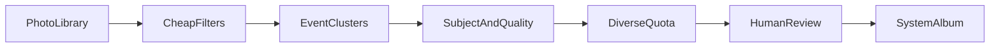

# 月次写真アルバム仕様

状態: 草案（2026-09-28）。この文書は実装を含みません。

関連: [README](README.md)、[端末と API](investigations/platform-capabilities.md)、[スコアリング](investigations/scoring.md)。

## 目的

Mixi のみてねと、TOLOT のプリントスクエアを使い、自宅で印刷する写真と、祖父母へ共有する写真を月に一度集めています。いまは iOS の写真アプリの中に手作業でアルバムを作り、各アプリではそのアルバムから選んでいます。アプリが複数あるので、選別をそれぞれのアプリの中でやり直すより、共通のアルバムを先に作る方が短い、というやり方です。

この仕様が扱うのは、その共通アルバムを作るまでの手間です。写真を「美しい作品」として採点すること自体は目的ではありません。月末に、印刷と共有へ渡せる枚数まで減っていることが目的です。

初版の対象は iOS です。Android は同じ成果物の契約を別実装で満たせるように、今の仕様に含めておきます。単一のソースコードにはしません。使い勝手がよければ、プラットフォームごとに別のアプリで構いません。

## 成功条件

次を満たした月を、成功した月とみなします。

- みてねとプリントスクエアの写真選択から、その月のアルバムを開ける。
- アルバムの枚数が、その月の撮影枚数よりはっきり少ない。上限は設定値で、初期値は 30 枚です。過去の手作業アルバムを見て変えます。
- 人が確認画面でやることは、採用、却下、足りない写真の追加が中心で、ゼロからアルバムを作る作業ではなくなっている。
- 祖父母へ渡したくない写真（別の家族のアップ、画面のキャプチャ、書類、ポケットの中の誤撮影が典型）が、確認を飛ばしてアルバムに入っていない。
- 採点も確定も、写真を端末の外へ出さずに終わる。

完全な自動確定は、この成功条件の外に置きます。誤った写真を祖父母へ届けるコストは、点数の誤差より大きいです。北の目標としては残し、初版の契約は「提案して確定」です。

時間の目安は、月末の作業が「アルバムを作る」から「候補を見て少し入れ替える」になることです。分数の目標は、過去の手作業の所要を一度測ってから決めます。測る前に分数を仕様へ固定しません。

## 非目標

- クラウドの推論 API、アカウント、写真のアップロード。
- OS が持つ「人物」データベースの読み取り。非公開の `Photos.sqlite` を解析することも含みます。
- みてねへの投稿、プリントスクエアでの発注、レイアウトの作成。
- 各アプリの非公開 API や、スクレイピング。
- 初版での動画の採点。Live Photos は静止画として扱います。
- 構図に合わせた自動クロップや、印刷用の余白計算。
- Flutter や Kotlin Multiplatform による単一コードベース。
- 家族の顔を個人識別すること。初版は「顔がある」「顔の写りがよい」「人が写っている」までです。

## 利用者と受け手

使う人は一名です。受け手は二人分の基準を持ちます。

**祖父母向け**に残したいのは、子どもや家族の顔が分かり、その月に何があったかが偏らない組です。少しブレていても、同じ笑顔の鋭い連写が 20 枚あるより価値があります。祖父母が見るのは、成長の記録です。

**印刷向け**に残したいのは、引き伸ばしても崩れにくい写真です。解像度、ブレの少なさ、露出、用紙との縦横比を見ます。日本の L 判は 89×127mm で、3:2 に近い縦横比です。スクエアの印刷を使う月は、別の比を設定で選べるようにします。

初版のアルバムは月につき一つです。いまの手作業が一つのアルバムを両方のアプリで使っているためです。内部では共有向けの点と印刷向けの点を分けて持ち、確認画面ではその写真がどちらの理由で残ったかを短く出します。あとからアルバムを二つに分けるときは、この二つの点をそのまま使います。

## ワークフロー

### いま

1. 月のあいだに写真がライブラリへたまる。
2. 月末に写真アプリを見ながら、よさそうなものを一つのアルバムへ入れる。
3. みてねでそのアルバムから共有する写真を選ぶ。
4. プリントスクエアで同じアルバムから印刷する写真を選ぶ。

手間の中心は 2 です。連写、よく似た構図、スクリーンショット、失敗カットが同じロールに混ざります。

### 目標

1. 計算ノードが、その月の新しい写真を安い条件から順にふるい、出来事ごとに候補を作る。
2. 人が確認画面で採用、却下、追加をする。
3. 確定すると、その月の名前のシステムアルバムが作られるか、中身が更新される。
4. 消費ノードのみてねとプリントスクエアで、そのアルバムを開いて選ぶ。

ショートカットの仕事は、月末に確認画面を開くことです。画像の中身を見てアルバムへ振り分ける仕事はアプリが持ちます。手元の iPhone 8 Plus（iOS 16）にも、Apple Intelligence のない iPad mini 5 にも、ショートカット単体でこの採点をする標準の手段がありません。詳細は [platform-capabilities.md](investigations/platform-capabilities.md) にあります。

## 成果物の契約

他アプリとの境界面は、システムに見えるアルバムです。

### iOS

- PhotoKit でユーザアルバムを作る。
- 写真そのものは複製しない。アルバムは所属のリストなので、カメラロールに残ったまま複数のアルバムへ入れられます。
- アルバム名は `共有と印刷 YYYY-MM` を初期値にします。月ごとに別アルバムにし、前月を上書きしません。
- 読み書き権限 (`readWrite`) が必要です。限定アクセスではユーザアルバムを作成できません。権限の説明文には「月末の共有と印刷のために、選んだ写真をアルバムへまとめる」と書きます。
- みてねとプリントスクエア側の実装には依存しません。接続できているかは、「そのアプリの写真選択に、このアルバムが出る」で確認します。いま手作業のアルバムでそれができているので、同じ種類のユーザアルバムを出します。

### Android（後続の別実装）

- 端末内の写真フォルダを、他アプリのピッカーから見える形で作ります。初期の置き場所は `Pictures/共有と印刷/YYYY-MM/` です。
- Android の一般的なアルバムはフォルダです。元のカメラフォルダから移動すると、撮影アプリから消えます。初版はコピーをフォルダへ置きます。確定後にアルバムから外すときは、そのコピーだけを消します。
- Google フォトのクラウドアルバムへ、アプリがアップロードしていない既存写真を足すことは、この契約に使いません。2025-03-31 以降、Photos Library API はアプリが作成したメディアに限られます。
- コピーなので容量が増えます。月 30 枚程度を想定し、フル解像度のコピーで足りるかを段階 3 の前に確認します。

### 再実行

同じ月を再度開いても、採用済みの写真をアルバムへ二重に足しません。却下した写真は、設定を変えない限り次の候補に戻しません。人が確認画面から明示して戻せます。

採用、却下、手追加は端末内に記録し、次月以降の評価に使います。この記録も外部へ送りません。

## アーキテクチャ

出力の契約を共有し、採点の実装はプラットフォームごとに持ちます。写真ライブラリへの書き込みと、オンデバイスの画像解析は OS の API に直結するためです。

### 計算ノードと消費ノード

| 端末 | 位置づけ |
| --- | --- |
| iPhone 8 Plus（A11、上限 iOS 16） | 主な撮影端末であり、みてねとプリントスクエアを開く消費ノード。美的スコア API はない。 |
| iPad mini 5（A12、iPadOS 26 対応） | 優先する計算ノード。Apple Intelligence はない。iOS 18 以降の Vision は OS 要件上は呼べる。速度は未計測。 |
| Pixel 10a（検討中） | 将来の Android 計算ノード。初版の必須機能にはしない。 |

**iCloud 写真がオン**で、iPad から同じライブラリを読める場合: iPad が採点してアルバムを書く。アルバムは iCloud 経由で iPhone の写真アプリへ現れ、iPhone 側のみてねがそれを開く。iPhone 8 Plus では採点しない。

**iCloud 写真がオフ**で、写真が撮影した端末にしかない場合: その端末が計算ノードになる。iPhone 8 Plus だけにライブラリがあるなら、iOS 16 で使える信号だけで採点し、確認と確定もその端末で行う。iPad の美的スコアは使わない。

どちらの分岐が現実かは未確認です。仕様は両方を残します。初回起動時に、直近 30 日の写真がこの端末にあるかを見せ、計算をここで行うかを人が選びます。

### 処理のタイミング

初版は、確認画面を開いたときに、その月の未処理分をフォアグラウンドで計算します。バックグラウンドでの全ライブラリ走査は後です。月次の処理は遅れてもよく、途中で OS に止められる処理より、人が待てる処理の方が結果が読めます。

採点は原寸をデコードしません。長辺の目安は 512px です。最適な辺長は [scoring.md](investigations/scoring.md) の計測で変えてよいです。顔が小さい写真で検出が落ちる場合は、その段だけ辺長を上げます。

## パイプライン

重い処理の前に、安い条件で落とします。順序は固定です。各段の中身の調整は [scoring.md](investigations/scoring.md) で行い、この順序は仕様です。

### 1. メタデータで外す

その月の作成日時を持つ写真を対象にします。初期の月境界はカレンダー月です。設定で「先月末から 30 日」へ変えられます。

次は候補生成から外します。

- スクリーンショット。
- 非表示の写真。
- 極端に小さい画像。初期しきい値は長辺 800px 未満。印刷向けにはあとで厳しくします。
- すでにこの仕組みで確定した写真。
- 動画。Live Photos は残します。

お気に入りは除外条件にしません。強い正の信号として後段へ渡します。

### 2. 出来事に束ねる

同じ連写は一つの束です。連写でなくても、近い時刻の写真は同じ出来事にまとめます。初期の間隔は 3 時間です。位置情報がある写真は、時刻が近くても場所が大きく離れていれば別の出来事にします。位置情報がない写真は時刻だけで束ねます。

目的は、同じ午後の 40 枚をアルバムへ全部入れないことです。束の中から代表を少数残し、残りは確認画面の「この出来事のほかのカット」から選べるようにします。代表の初期値は、束あたり最大 2 枚です。

### 3. 主題

各写真について、少なくとも次を取ります。

- 顔の有無、顔の個数、顔の写りの点。
- 取れれば、笑顔と開眼。iOS 16 では古い検出器の結果を使い、Android では ML Kit の確率を使います。精度は段ごとに違ってよいです。
- 人がフレームにいるか。
- 風景、建物、料理、書類、画面、といったシーンのラベル。
- 視線が集まる領域があるか。

家族の誰であるかは取りません。

### 4. 写真としての質

- ブレ（鮮鋭度）。
- 露出の極端さ。
- 画素の大きさ。
- iPadOS 18 以降で計算ノードが対応しているときだけ、美的な総合点と、書類やレシートなどの utility 判定。utility と判定された写真は、総合点が高くても候補から外します。

美的な総合点は印刷向けの追加信号です。共有向けの順位を、この一点では決めません。

### 5. 月の枠

得点の上位から機械的に 30 枚を切りません。出来事のカバーを優先します。

1. 各出来事から代表を選ぶ。共有向けは顔の写りを優先し、印刷向けの下限（ブレ、サイズ）を下回るものは代表にしにくい、という合成で選ぶ。
2. 月の中の日ができるだけ散らばるように、枠が埋まるまで足す。
3. 枠が余れば、印刷向けの点が高い写真を足す。
4. 人がお気に入りにしている写真は、枠の計算で落としにくい扱いをする。枠を超える場合は確認画面で超過として見せ、自動では入れません。

共有向けと印刷向けの重みの初期値は [scoring.md](investigations/scoring.md) に置きます。過去アルバムとの照合で変えます。

### 6. 人が確定する

確定するまでアルバムは作りません。再実行でアルバムが既にある場合は、採用の差分だけを追加し、却下された所属は外します。iOS では所属を外しても写真ファイルは残ります。Android ではコピーを消します。

## 確認画面

初版で必要な挙動は次です。見た目の詳細は実装時に決めます。

- 対象の月を選ぶ。初期表示は直前のカレンダー月です。
- 採用候補をグリッドで見る。各写真に、残った短い理由を出す（例: 顔の写り、この日の代表、お気に入り、印刷向けの鮮鋭度）。
- 採用と却下を切り替える。
- 同じ出来事のほかのカットを開いて入れ替える。
- その月のライブラリから、候補に無い写真を手で足す。感情的に残したいブレた写真のための抜け道です。
- 目標枚数と、いまの採用数を出す。
- 確定する。権限が無いときは、権限の理由を示してからシステムダイアログを出す。
- 確定後に、写真アプリでそのアルバムを開く導線を出す。

計算中は、終わった出来事から順に表示してよいです。月全体の完了を待たなくても、確認を始められます。

## 権限とプライバシー

対象は子どもと家族の写真です。次を守ります。

- 推論、特徴量、採用と却下の記録は、その端末の中だけで完結する。
- 初版の設定に、外部 API へ画像を送るスイッチを置かない。
- 顔の同一性は保存しない。保存してよいのは、顔の個数、写りの点、笑顔や開眼の点、人がいるか、です。
- 位置情報は出来事の分割にだけ使い、アルバムのメタデータへ新たに書き出さない。
- 限定アクセスや、Android の一部の写真だけ許可するモードでは、全月の走査とアルバム作成ができないことを画面に書く。全写真へのアクセスを求める理由は、月の取りこぼしを減らすためです。
- ローカルの記録を消す操作を用意する。アルバムに既に入った写真の所属は、人がアルバムから外すまで残してよいです。

App Store に出す場合は、写真ライブラリ全体を読む目的の説明が審査対象になります。個人利用の導入（開発者署名や TestFlight）を先にします。公開の要否は未決です。

## 段階

### 段階 0: 手作業アルバムを評価セットにする

実装の前に、過去に自分で作った月次アルバムを 2〜3 か月分、名前と枚数だけ控えます。可能なら、その月の撮影枚数も控えます。システムの候補と、実際に印刷・共有したものの重なりを、最初の調整に使います。抽象的な美的スコアの調整から始めません。

### 段階 1: 提案と確定

iOS で、パイプライン、確認画面、ユーザアルバムへの書き込みまで作ります。計算ノードの選択は、iCloud の有無に沿って初回に決めます。iPad mini 5 で美的スコアが実用的な速度なら使い、遅ければその信号を切ったまま段階 1 を完了してよいです。

### 段階 2: 月末に開く

App Intent を用意し、ショートカットの月末オートメーションから確認画面を開きます。採点ロジックはショートカットへ移しません。

### 段階 3: Android

Pixel を使うことになった時点で、別実装で同じ契約（他アプリのピッカーから見える月次フォルダ、提案して確定、端末内の採点）を満たします。iOS のコードの移植は要求しません。

## 判断の理由

月末の成果は、二つのアプリへ渡せる薄い束です。美しい 1 枚を当てることより、その月の出来事が欠けず、渡してはいけないものが混ざらないことの方が、この作業では価値があります。順位は、出来事のカバーと、共有向け・印刷向けの二つの点で作ります。

構図のよさは、文献でも実装でも一番不安定な因子です。印刷物で先に効くのは、解像度とブレと用紙比です。構図に相当する信号は、顕著性や美的総合点として補助に残し、初版の主因にしません。

iPhone 8 Plus を採点の前提にすると、iOS 16 の検出器だけで家族写真の選別を完結させることになります。iPad mini 5 は同じ iCloud ライブラリを読めるなら、より新しい Vision を電源につないだ状態で回せます。撮影端末と計算端末を分けられるのは、アルバムが iCloud で同期する所属リストだからです。この同期が無い場合だけ、撮影端末が計算します。

ショートカットは、写真アプリのアルバムを月末に開くところまでが得意です。中身の判定をショートカットへ寄せると、手元の端末ではすぐ頭打ちになります。アプリにすると権限と審査は重くなりますが、個人の導入ならその重さは、毎月の手作業より小さい想定です。公開して利用者を増やす前提では作りません。

家族の名前を OS の「人物」から読めないことは、欠落として残します。第三者アプリ向けの API が無いためです。名前で「この子の月」を作る機能は、非公開データベースを読むことと引き替えにはしません。誰が写っているかは、確認画面で人が残します。

過去に手で入れたアルバムは、この利用者にとっての正解です。一般の美的データセットで合わせたモデルは、祖父母が欲しい「少しブレていても顔が分かる」を落としやすいです。評価は自分の過去アルバムとの重なりで行います。

## 未決事項

実装を始める前に、次だけは実機で一度見れば十分です。仕様の分岐は書いてあるので、文書を止める理由にはしません。

- iCloud 写真がオンか。iPad に直近の月の写真が見えるか。
- 過去の月次アルバムの枚数。初期上限 30 を変えるかの材料です。
- iPad mini 5 で、美的スコアを長辺 512px の写真にかけたときの 1 枚あたりの時間。
- 共有ライブラリ（パートナーが撮った写真）を同じ月次アルバムへ含めるか。初版の実装は、個人ライブラリに見える写真を対象にします。
- アルバム名の文言。初期値は `共有と印刷 YYYY-MM` です。
